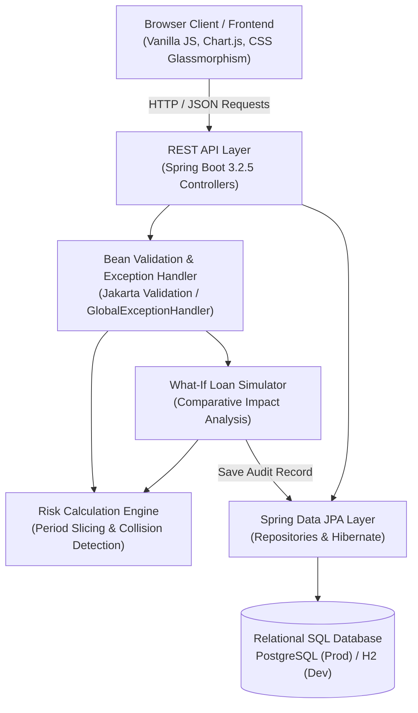

# EMI Stacking Risk Detector 🛡️

[](https://github.com/vinodhini2312/EMI-Stacking-Risk-Detector/actions/workflows/ci.yml)
[](https://github.com/vinodhini2312/EMI-Stacking-Risk-Detector/actions/workflows/pages.yml)
[](https://vinodhini2312.github.io/EMI-Stacking-Risk-Detector/)
[](https://spring.io/projects/spring-boot)
[](https://www.oracle.com/java/)
[](https://www.postgresql.org/)
[](LICENSE)

> 🚀 **Live Interactive Demo**: [https://vinodhini2312.github.io/EMI-Stacking-Risk-Detector/](https://vinodhini2312.github.io/EMI-Stacking-Risk-Detector/)

An intelligent, full-stack fintech web application and risk-detection engine built to identify **multi-loan EMI stacking collisions**, forecast cashflow deficits across upcoming pay cycles, and evaluate new loans or Buy-Now-Pay-Later (BNPL) purchases using a predictive **What-If EMI Simulator** before signing loan agreements.

---

## 📌 Table of Contents
- [Problem Statement](#-problem-statement)
- [Project Overview & Objectives](#-project-overview--objectives)
- [System Architecture](#-system-architecture)
- [Risk Assessment Methodology & Formulas](#-risk-assessment-methodology--formulas)
- [Implemented Features](#-implemented-features)
- [Technology Stack](#-technology-stack)
- [Database Schema & Architecture](#-database-schema--architecture)
- [Local Setup & Prerequisites](#-local-setup--prerequisites)
- [Configuration & Environment Variables](#-configuration--environment-variables)
- [Automated Testing & QA Verification](#-automated-testing--qa-verification)
- [REST API Documentation](#-rest-api-documentation)
- [Containerization & Deployment](#-containerization--deployment)
- [Security Considerations](#-security-considerations)
- [Known Limitations & Future Scope](#-known-limitations--future-scope)
- [License](#-license)

---

## 🛑 Problem Statement

Modern retail borrowers and gig-economy workers frequently hold multiple credit obligations simultaneously across separate lenders—such as bank personal loans, smartphone zero-cost EMIs, two-wheeler financing, credit card balances, and fintech BNPL purchases.

Each lender evaluates affordability in isolation (e.g., confirming an EMI of ₹4,500 is affordable against a monthly income of ₹36,000). However, existing banking applications fail to track **payment date collisions**:
* Consider an applicant with a **₹9,000 weekly income** managing three separate, seemingly affordable loans:
  * Personal Loan: **₹6,500** due on the **5th**
  * Phone EMI: **₹4,500** due on the **6th**
  * Vehicle Loan: **₹3,200** due on the **8th**
* In isolation, each loan appears within budget. But between the **5th and 11th** of the month, their obligations stack to **₹14,200**, resulting in an immediate **₹5,200 cash deficit** and bounce charges.
* Taking on even a modest additional loan (e.g., a ₹3,000 gadget EMI) cascades into payment default across multiple institutions.

**EMI Stacking Risk Detector** solves this blind spot by aligning repayment schedules against recurring income timelines and pinpointing exact shortfall weeks before new loan commitments are finalized.

---

## 🎯 Project Overview & Objectives

1. **Detect Temporal Stacking**: Project repayment obligations across an 8-to-24-week timeline to expose multi-lender payment collisions.
2. **What-If Loan Simulation**: Provide prospective borrowers with a sandbox to test hypothetical new loans and receive an automated "Safe to Take" or "Shortfall Risk" verdict.
3. **Auditable Risk Persistence**: Persist applicant loan books, customized income schedules, and simulation audit logs into an SQL relational database.
4. **Actionable Financial Transparency**: Replace opaque credit scores with transparent cashflow metrics: Net Buffer, Peak Shortfall, and Specific Collision Weeks.

---

## 🏗️ System Architecture



The system employs a clean, layered architecture separating user interface, API orchestration, mathematical risk calculation, and relational persistence.

---

## 🧮 Risk Assessment Methodology & Formulas

The core calculation engine operates on calendar-aligned weekly intervals (Monday through Sunday) over an 8-week horizon.

### 1. Mathematical Formulas
For each week $w \in [1, N]$:

$$\text{Available Amount}_w = \text{Expected Income}_w - \text{Total EMI Due}_w$$

$$\text{Shortfall Amount}_w = \max(0, \text{Total EMI Due}_w - \text{Expected Income}_w)$$

### 2. Risk Classification Matrix

| Risk Level | Condition | Explanation | User Verdict |
| :--- | :--- | :--- | :--- |
| **`SHORTFALL`** 🔴 | $\text{Available Amount}_w < 0$ | Total combined EMI exceeds expected income. | **Action Required**: Loan bounce risk. |
| **`WARNING`** 🟠 | $\frac{\text{Available Amount}_w}{\text{Expected Income}_w} < 0.15 \lor \text{Available Amount}_w < 1500$ | Income covers EMI, but remaining emergency buffer is $< 15\%$ or $< ₹1,500$. | **Caution**: Very tight liquidity margin. |
| **`SAFE`** 🟢 | $\text{Available Amount}_w \ge 1500 \land \text{Buffer} \ge 15\%$ | Sufficient surplus remains after all EMI deductions. | **Safe**: No payment collision. |

### 3. Simulation Impact Formula
When evaluating a proposed loan $L_{\text{new}}$:
$$\Delta \text{Risky Weeks} = \text{Risky Weeks}_{\text{after}} - \text{Risky Weeks}_{\text{before}}$$
$$\text{Max Projected Shortfall} = \max_{w} (\text{Shortfall Amount}_{w, \text{after}})$$

If $\Delta \text{Risky Weeks} > 0$ or $\text{Risky Weeks}_{\text{after}} > 0$, the verdict is classified as **`SHORTFALL_RISK`** with an explicit list of newly compromised weeks.

> **Methodological Disclaimer**: The model evaluates deterministic cashflow collision risk based on applicant-reported income and repayment obligations. It does not replace credit bureau scoring (e.g., CIBIL/Experian), but acts as an upstream cashflow viability validator.

---

## ✨ Implemented Features

### 1. 📊 Real-Time Financial Dashboard
* **Affordability Verdict Banner**: Immediate visual answer to whether upcoming EMI payments are affordable.
* **Key Metric Counters**: Active loan count, total monthly commitment, expected monthly income, current week available buffer, and safe/warning/shortfall week distribution.
* **Interactive 8-Week Cashflow Chart**: Dynamic Chart.js timeline with income threshold overlays, stacked EMI bars, and shortfall highlights.
* **14-Day Upcoming Payment Queue**: Chronological list of next maturing payments with lender name, due date, and amount.

### 2. ⚡ What-If Loan Simulator (Flagship)
* Input hypothetical new loans (Lender/Item name, Loan Category, EMI amount, First due date, Duration, Frequency).
* **Before vs. After Comparative Matrix**: Side-by-side comparison of active obligations, buffers, and compromised weeks.
* **Newly Created Risky Weeks Table**: Pinpoints the exact future weeks transitioning from safe to deficit.
* **Audit Trail**: Every simulation is automatically persisted to the SQL `simulation_audits` table.
* **One-Click Commit**: Instantly adds simulated loans to active loans upon approval.

### 3. 📅 Multi-Period Risk Calendar
* Configurable 4, 8, or 12-week cashflow ledger.
* Detailed inspection modal showing all individual loans contributing to each week's total.

### 4. 💳 Loan & Debt Management
* Full CRUD (Create, Read, Update, Delete) for Personal Loans, Phone/Device Financing, Vehicle Loans, BNPL, Education Loans, and Other debts.
* Input validation preventing negative EMIs, out-of-range dates, or blank lender names.
* Pre-loaded with realistic Indian fintech seed data.

### 5. 💰 Income Configuration Engine
* Support for **Weekly**, **Biweekly**, **Monthly**, and **Custom multi-stream** schedules (Salary, Freelance, Rental).

### 6. 📈 Reports & Audit History
* Custom date-range financial audits with JSON data export and print-ready summary views.
* `/api/simulator/history` endpoint for regulatory or compliance audit inspection.

---

## 🛠️ Technology Stack

| Layer | Technology | Details |
| :--- | :--- | :--- |
| **Backend Framework** | Spring Boot 3.2.5 | Java 17 / 22, Spring Web MVC, Spring Validation |
| **ORM / Data Access** | Spring Data JPA / Hibernate 6.4 | Entity mapping, transactional boundaries, repository pattern |
| **Relational Database** | PostgreSQL & H2 | PostgreSQL (production), H2 file/mem (local development) |
| **Frontend UI** | HTML5, Vanilla CSS3, JavaScript (ES6+) | Obsidian fintech dark theme, glassmorphism, zero heavy runtime frameworks |
| **Data Visualization** | Chart.js 4.4.2 | Interactive grouped bar and doughnut charts |
| **Build & Dependency Tool** | Apache Maven 3.9+ | Standardized lifecycle, multi-module packaging |
| **Containerization** | Docker & Docker Compose | Multi-stage build, minimal alpine JRE image |
| **CI/CD** | GitHub Actions | Automated build, dependency caching, surefire test runs |

---

## 🗄️ Database Schema & Architecture

The application connects to an SQL relational database through JPA entities. Below is the relational schema:

```
+-----------------------------------------------------------+
|                          loans                            |
+-----------------------------------------------------------+
| id (VARCHAR 64, PK)                                       |
| lender_name (VARCHAR 255, NOT NULL)                       |
| loan_type (VARCHAR 50, NOT NULL)                          |
| emi_amount (DOUBLE PRECISION, NOT NULL)                   |
| due_day_of_month (INT, NOT NULL)                          |
| start_date (DATE)                                         |
| duration_months (INT)                                     |
| end_date (DATE)                                           |
| frequency (VARCHAR 20 DEFAULT 'MONTHLY')                  |
| total_principal (DOUBLE PRECISION)                        |
| notes (VARCHAR 1000)                                      |
| active (BOOLEAN DEFAULT TRUE)                             |
| created_at (TIMESTAMP)                                    |
+-----------------------------------------------------------+

+-----------------------------------------------------------+
|                     income_patterns                       |
+-----------------------------------------------------------+
| id (VARCHAR 64, PK)                                       |
| pattern_type (VARCHAR 50, NOT NULL)                       |
| default_amount (DOUBLE PRECISION, NOT NULL)               |
| pay_day_of_month (INT)                                    |
| pay_day_of_week (INT)                                     |
| next_pay_date (DATE)                                      |
| updated_at (TIMESTAMP)                                    |
+-----------------------------------------------------------+
       | 1
       | has many
       v *
+-----------------------------------------------------------+
|                    income_schedules                       |
+-----------------------------------------------------------+
| id (VARCHAR 64, PK)                                       |
| pattern_id (VARCHAR 64, FK -> income_patterns.id)         |
| source_name (VARCHAR 255, NOT NULL)                       |
| amount (DOUBLE PRECISION, NOT NULL)                       |
| expected_date (DATE, NOT NULL)                            |
| recurring (BOOLEAN DEFAULT TRUE)                          |
+-----------------------------------------------------------+

+-----------------------------------------------------------+
|                    simulation_audits                      |
+-----------------------------------------------------------+
| id (VARCHAR 64, PK)                                       |
| created_at (TIMESTAMP, NOT NULL)                          |
| loan_name (VARCHAR 255)                                   |
| loan_type (VARCHAR 50)                                    |
| emi_amount (DOUBLE PRECISION, NOT NULL)                   |
| first_due_date (DATE)                                     |
| frequency (VARCHAR 20)                                    |
| duration_months (INT)                                     |
| verdict (VARCHAR 50, NOT NULL)                            |
| verdict_badge (VARCHAR 100)                               |
| max_projected_shortfall (DOUBLE PRECISION)                |
| before_risky_weeks (INT)                                  |
| after_risky_weeks (INT)                                   |
| current_weekly_income (DOUBLE PRECISION)                  |
| current_weekly_emi (DOUBLE PRECISION)                     |
| after_weekly_emi (DOUBLE PRECISION)                       |
| after_weekly_buffer_or_shortfall (DOUBLE PRECISION)        |
| newly_risky_weeks_count (INT)                             |
+-----------------------------------------------------------+
```

---

## 💻 Local Setup & Prerequisites

### Prerequisites
* **Java Development Kit (JDK)**: JDK 17 or higher (tested on OpenJDK 17 and Oracle JDK 22).
* **Apache Maven**: Version 3.8+ (`mvn -v`).
* **Git**: Version 2.20+.

### 1. Clone the Repository
```bash
git clone https://github.com/vinodhini2312/EMI-Stacking-Risk-Detector.git
cd EMI-Stacking-Risk-Detector
```

### 2. Configure Environment (Optional)
By default, the application runs out of the box using an embedded H2 database located in `./data/emiguard`.
To configure custom database or port settings, copy `.env.example`:
```bash
cp .env.example .env
```

### 3. Run the Application
```bash
# Compile and run via Spring Boot Maven plugin:
mvn spring-boot:run
```
Or package a standalone executable JAR:
```bash
mvn clean package -DskipTests
java -jar target/emi-stacking-risk-detector-1.0.0.jar
```

### 4. Access the Application
* **Web Dashboard**: [http://localhost:8080](http://localhost:8080)
* **H2 SQL Database Console**: [http://localhost:8080/h2-console](http://localhost:8080/h2-console)
  * JDBC URL: `jdbc:h2:file:./data/emiguard`
  * Username: `sa`
  * Password: *(leave blank)*

---

## ⚙️ Configuration & Environment Variables

| Variable | Description | Default Value | Example (Production) |
| :--- | :--- | :--- | :--- |
| `PORT` | Server listening port | `8080` | `8080` / `10000` |
| `SPRING_DATASOURCE_URL` | JDBC connection string | `jdbc:h2:file:./data/emiguard;DB_CLOSE_DELAY=-1;AUTO_SERVER=TRUE` | `jdbc:postgresql://ep-xyz.aws.neon.tech/emiguard` |
| `SPRING_DATASOURCE_USERNAME` | Database username | `sa` | `emiguard_user` |
| `SPRING_DATASOURCE_PASSWORD` | Database password | *(empty)* | `mypassword123` |
| `SPRING_DATASOURCE_DRIVER` | Database JDBC driver | `org.h2.Driver` | `org.postgresql.Driver` |
| `SPRING_JPA_HIBERNATE_DDL_AUTO` | Hibernate schema mode | `update` | `update` / `validate` |
| `SPRING_H2_CONSOLE_ENABLED` | Enable web H2 console | `true` | `false` |

---

## 🧪 Automated Testing & QA Verification

The project includes an automated test suite verifying database operations, financial calculation accuracy, edge cases, and REST endpoints.

### Execute All Tests
```bash
mvn clean test
```

### Verified Test Suite Breakdown (21 Tests, 0 Failures)
* **`RiskCalculationEngineTest`** (5 tests):
  * Multi-loan temporal stacking exceeding income triggers `SHORTFALL_RISK` and exact shortfall amounts.
  * Applicant with 0 existing loans returns `SAFE` with full income available.
  * Loan payments lower than income register as `SAFE`.
  * Zero income with active EMI calculates exact negative deficit and triggers `SHORTFALL`.
  * Thin buffer ($< 15\%$ or $< ₹1,500$) correctly triggers `WARNING` (Tight Margin).
* **`SimulatorServiceTest`** (3 tests):
  * Adding a loan that causes cashflow deficit detects newly compromised weeks.
  * Adding an affordable loan returns `SAFE_TO_TAKE`.
  * Invalid/zero EMI simulation throws validation errors.
* **`LoanServiceDatabaseTest`** (4 tests):
  * JPA CRUD: insert, read, update, delete loans against database.
  * Multi-frequency monthly obligation aggregation (Weekly $\times 4$, Biweekly $\times 2$, Monthly $\times 1$).
  * Automated sample data seeding validation.
  * Invalid loan parameters throw `IllegalArgumentException`.
* **`ApiControllerIntegrationTest`** (9 tests):
  * `GET /api/dashboard`: returns HTTP 200 with complete financial metrics.
  * `GET /api/loans`: returns stored loan lists.
  * `POST /api/loans`: verifies valid loan creation.
  * `POST /api/loans`: rejects invalid payloads (negative EMI, day $> 31$) with HTTP 400 and structured validation errors.
  * `POST /api/simulator/simulate`: generates simulation result and verifies database audit persistence.
  * `GET /api/simulator/history`: verifies retrieval of past simulation audits.
  * `GET /api/income`: verifies default pattern structure.
  * `GET /api/risk/calendar`: verifies timeline slicing.
  * `GET /api/reports`: verifies date-filtered financial health reporting.

---

## 📡 REST API Documentation

### 1. Dashboard & Risk
* `GET /api/dashboard` — Returns current active loan summary, upcoming payments, 8-week period breakdown, and affordability verdict.
* `GET /api/risk/calendar?weeks=8` — Returns weekly period risk assessments starting from anchor date.
* `GET /api/risk/analysis?weeks=8` — Aggregated risk distribution (safe, warning, shortfall counts, peak shortfall).
* `GET /api/risk/upcoming-payments?daysAhead=30` — Chronological payment schedule for upcoming $N$ days.

### 2. Loan Management
* `GET /api/loans` — List all active and inactive loans sorted by due day.
* `GET /api/loans/{id}` — Fetch specific loan by ID.
* `POST /api/loans` — Create a new loan. Requires JSON body with `@Valid` constraints:
  ```json
  {
    "lenderName": "HDFC Personal Loan",
    "loanType": "PERSONAL_LOAN",
    "emiAmount": 6500.0,
    "dueDayOfMonth": 5,
    "startDate": "2026-07-05",
    "durationMonths": 24,
    "frequency": "MONTHLY",
    "totalPrincipal": 150000.0,
    "notes": "Debt consolidation"
  }
  ```
* `PUT /api/loans/{id}` — Update existing loan.
* `DELETE /api/loans/{id}` — Delete loan from database.
* `POST /api/loans/reset` — Reset loan book to default sample seed.
* `GET /api/loans/types` — Returns supported loan categories with display names and icons.

### 3. Simulator
* `POST /api/simulator/simulate` — Execute What-If simulation for a proposed loan:
  ```json
  {
    "loanName": "Apple iPhone 15 Pro",
    "loanType": "PHONE_DEVICE_LOAN",
    "emiAmount": 4500.0,
    "firstDueDate": "2026-11-06",
    "frequency": "MONTHLY",
    "durationMonths": 12
  }
  ```
* `GET /api/simulator/history` — Fetch all audited simulations stored in the database.

### 4. Income & System
* `GET /api/income` — Retrieve active income pattern.
* `POST /api/income` — Update income pattern (Weekly, Biweekly, Monthly, or Custom).
* `POST /api/system/reset-sample-data` — Restores sample loan stack and income schedule.
* `POST /api/system/clear-all-data` — Clears all database records.

---

## 🚀 Containerization & Deployment

### Run via Docker Compose (with PostgreSQL)
The project includes a ready-to-run `docker-compose.yml` that provisions the Spring Boot application and a dedicated PostgreSQL database container:

```bash
docker-compose up --build
```
This starts:
* PostgreSQL on port `5432` with automatic health checks.
* EMI Stacking Risk Detector on port `8080`.

### Deploying to Cloud Platforms (Render / Railway / Fly.io / Heroku)
1. **Repository**: Push code to GitHub.
2. **New Web Service**: Connect your GitHub repository.
3. **Environment**: Select **Docker** or **Java 17/21 Maven**.
4. **Environment Variables**:
   * If connecting to managed PostgreSQL (e.g., Render Postgres / Supabase / Neon):
     * `SPRING_DATASOURCE_URL`: `jdbc:postgresql://<host>:<port>/<dbname>`
     * `SPRING_DATASOURCE_USERNAME`: `<username>`
     * `SPRING_DATASOURCE_PASSWORD`: `<password>`
     * `SPRING_DATASOURCE_DRIVER`: `org.postgresql.Driver`
   * If using default embedded storage, no environment variables are required! The application automatically listens on the dynamically assigned `$PORT`.

---

## 🔒 Security Considerations

* **Credential Protection**: Zero database credentials, passwords, or API keys are committed to the codebase. All configurations utilize environment variable overrides (`${VAR:default}`).
* **SQL Injection Prevention**: All database access is conducted through Spring Data JPA and Hibernate parameterized queries.
* **Input Sanitization & Validation**: Jakarta Bean Validation (`@Valid`, `@NotBlank`, `@Positive`, `@Min`, `@Max`) enforces clean inputs across all endpoints.
* **Privacy by Design**: The application does not collect or store government IDs, Aadhaar numbers, PAN cards, or bank login credentials.

---

## 🔮 Known Limitations & Future Scope

### Known Limitations
* **Fixed Due Dates**: The current weekly projection assumes EMIs recur on fixed calendar days of the month. Holiday banking rollover adjustments (e.g., due date shifting from Sunday to Monday) are not yet modeled.
* **Variable Income**: Irregular gig workers without consistent weekly or monthly schedules must configure individual custom schedules.

### Future Improvements
* Account Aggregator (AA) framework integration for automated real-time bank statement parsing.
* SMS notification alerts 48 hours prior to high-risk EMI collision windows.
* Multi-currency support (USD, EUR, GBP) alongside INR.

---

## 📄 License

This project is licensed under the MIT License - see the [LICENSE](LICENSE) file for details.
